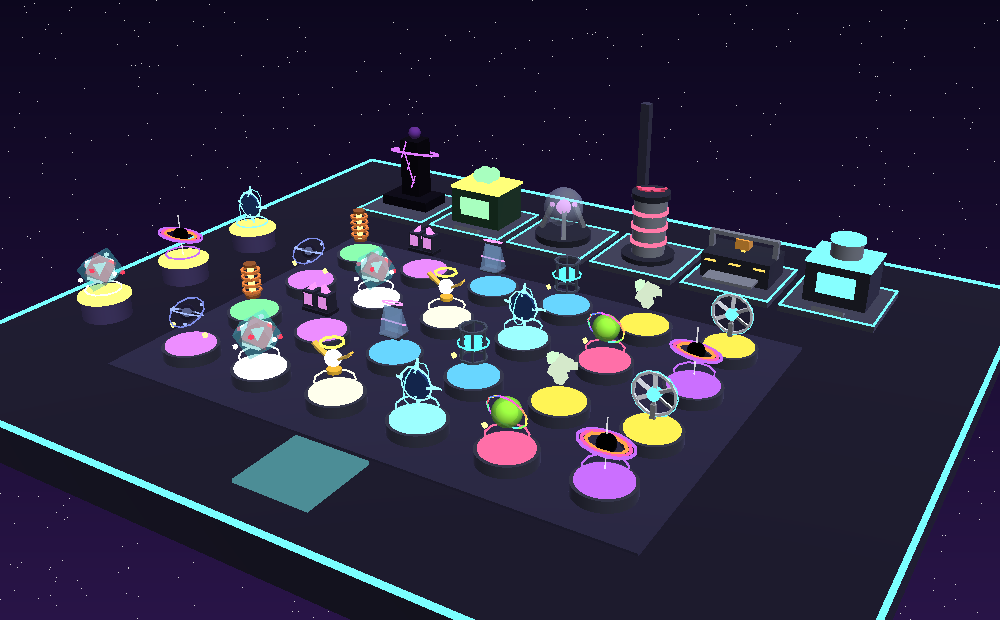

# VOID FACTORY

Simulador de fábrica para Roblox. Empiezas en una plataforma flotante en el vacío con una
máquina que fabrica cajas misteriosas. Cada caja contiene un artefacto de una de 10 rarezas;
colócalos en pedestales para producir **Energy**, compra y mejora máquinas, amplía la parcela,
completa la colección y haz **rebirth** para obtener bonificaciones permanentes.

## Probarlo ya (sin instalar nada)

1. Descarga [`build/VoidFactory.rbxl`](build/VoidFactory.rbxl).
2. Ábrelo en **Roblox Studio** (doble clic o *File → Open from File*).
3. Pulsa **Play** (F5). El mundo, las parcelas y la interfaz se construyen al arrancar.

En Studio el botón 🛠️ **Debug** del menú izquierdo da Energy, avanza el tiempo, regala
artefactos o reinicia tus datos para probar la progresión en segundos.

Para publicar la experiencia: [docs/PUBLISHING.md](docs/PUBLISHING.md).

*Render aproximado generado a partir de los modelos reales del juego con
`tools/preview` (no es una captura de Roblox). Más: [artefactos](docs/images/artifacts.png),
[máquinas](docs/images/machines.png).*

## Qué incluye

| Sistema | Detalles |
| --- | --- |
| Artefactos | 15 del catálogo base + 1 de evento, cada uno con modelo 3D procedural propio, 10 rarezas, efectos de partículas y luz según rareza |
| Efectos especiales | Reactor (producción global), Amplificador (vecinos), Distorsión (suerte), Duplicador, Acelerador, Entropía (riesgo/recompensa), Singularidad (combina efectos) y Oleada del Vacío (altera toda la fábrica) |
| Mutaciones | Gold, Neon, Rainbow (animada) y Corrupted (x5 pero drena a los vecinos) |
| Máquinas | Starter Fabricator (gratis), Box Printer (automática), Overclocker, Fusion Chamber, Lucky Fabricator y Void Forge (tras rebirth); todas mejorables |
| Fábrica | Parcela por jugador con 6 → 24 pedestales (5 ampliaciones), vitrina con tus hallazgos más raros, cartel con tu producción |
| Progresión | Mejoras de suerte, velocidad y almacén; misiones; colección con bonus permanente; rebirth con tienda de ventajas (Void Shards) |
| Claridad | Etiquetas de producción sobre cada pedestal, enlaces de neón entre artefactos que se potencian/drenan, vista previa de Energy/s al colocar, probabilidades reales visibles |
| Eventos | Evento de servidor cada 30 min (Luck Storm, Overdrive, Rapid Fabrication, Mutation Rain) y eventos de temporada con artefactos propios |
| Multijugador | Hasta 8 jugadores, visitas a otras fábricas, clasificaciones del servidor y globales, anuncios de hallazgos extraordinarios |
| Guardado | DataStore con bloqueo de sesión, reintentos, validación antes de guardar y guardado al cerrar el servidor |
| Seguridad | Todo se calcula en el servidor; una única RemoteFunction con validación de argumentos y límite de frecuencia por acción |
| Interfaz | Adaptada a PC y móvil, animaciones, consejos de inicio, ajustes de sonido y de efectos visuales |

## Cómo se juega

- **OPEN BOX** (abajo) abre una caja en la máquina seleccionada. **AUTO** sigue abriendo solo.
- Toca un **pedestal** para ver su producción, retirar o cambiar el artefacto. Desde 🎒 Items
  puedes colocar, vender, fusionar (3 iguales → ★) o usar *Auto-place best*.
- Los artefactos con efecto de vecindad potencian (o drenan) los pedestales de al lado: la
  posición importa. Al colocar, cada pedestal muestra cuánta Energy/s ganarías ahí.
- 📖 **Collection → Odds** muestra las probabilidades exactas con tu suerte actual.

## Estructura

| Carpeta | Contenido |
| --- | --- |
| `src/shared/Config` | Catálogos y balance (artefactos, rarezas, cajas, máquinas, mejoras, eventos, misiones, sonidos) |
| `src/shared/Logic` | Reglas del juego puras y deterministas, compartidas por servidor y cliente |
| `src/shared/Visuals` | Modelos procedurales de artefactos y máquinas |
| `src/server/Services` | Red, datos, mundo, parcelas, sesiones, simulación, clasificaciones, administración |
| `src/client` | Interfaz, animaciones y controladores |
| `tests/` | 86 pruebas en Lune con un entorno simulado de Roblox validado contra la API oficial |
| `tools/` | Verificación completa, simulador de economía, generador de sonidos, vistas previas de los modelos |
| `assets/sounds` | 15 efectos de sonido originales listos para subir |

## Documentación

- [Publicar la experiencia](docs/PUBLISHING.md)
- [Añadir artefactos, máquinas, eventos…](docs/EXTENDING.md)
- [Economía y ritmo de progresión](docs/ECONOMY.md)
- [Sonidos](docs/SOUNDS.md)
- [Desarrollo y herramientas](docs/DEVELOPMENT.md)
- [Qué está probado y qué no](docs/TESTING.md)
